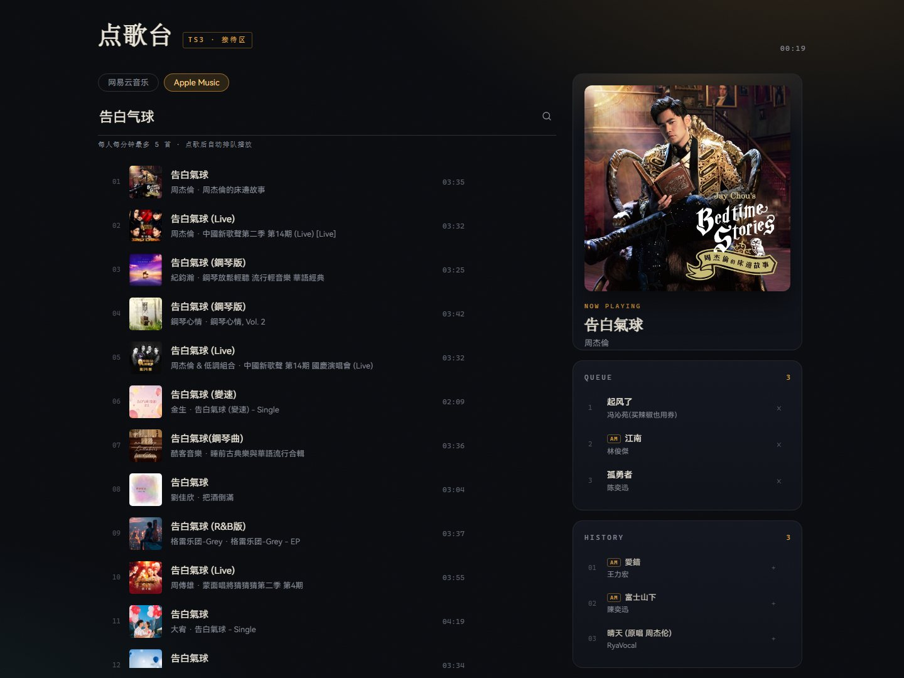
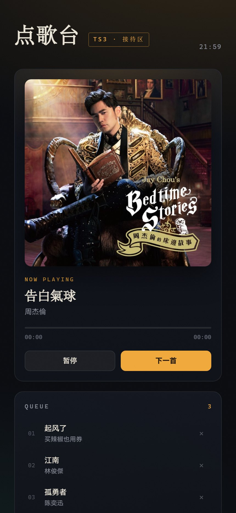

# TS3 点歌台 · ts3-jukebox

TeamSpeak 3 的网页点歌台：浏览器搜歌 → 点歌 / 插播 → 自动排队 → 机器人逐首播放。
音源做成插件，自带 **网易云音乐** 与 **Apple Music** 两个实现。

---

## 这是什么

在 TeamSpeak 里放歌，传统做法是在频道里敲 <code>!play &lt;链接&gt;</code>：要找链接、要手动排队、中文歌经常找不到资源。
这个项目把「点歌」搬进网页：

- 网页里搜歌，点「点歌」进队列，「插播」排到下一首
- 面板自己维护队列，按顺序把可播放地址推给 [TS3AudioBot](https://github.com/Splamy/TS3AudioBot)
- 重启面板不丢队列（状态落盘），一首放完自动下一首
- 音源是插件：想要别的平台，照着接口加一个文件即可

它**不是** TS3 服务器本体，也不替代 TS3AudioBot —— 它是两者之间的一层「点歌台」。
实测部署：一台 2C/1.6G 的 Debian 12 云服务器，和 TeamSpeak、TS3AudioBot、网易云 API、gamdl 跑在同一台机器上，稳定占用约 30 MB 内存。

## 部署效果

桌面端（搜索 Apple Music + 右侧正在播放与队列）：

手机端（竖屏自适应，适合聚会时随手点歌）：

实际使用时的表现：

- 搜索：网易云 / Apple Music 各 20 条结果，带封面、时长、歌手
- 点歌：立刻进队列；轮到它时自动播放，正在播放卡片显示进度
- 网易云：直接拿 CDN 直链播放，几乎无延迟
- Apple Music：点歌后后台用 gamdl 下载解密（约 8~12 秒），下完即播；同一首歌再点直接命中缓存
- 限流：默认每人每分钟 5 首，防止刷屏
- 面板重启：队列和正在播放恢复正常，机器人不受影响

## 架构

    浏览器 ──HTTP──► ts3-jukebox (Python 标准库，无第三方依赖)
                        │
                        ├─ 插件 netease ──► NeteaseCloudMusicApi ──► CDN 直链
                        ├─ 插件 applemusic ──► gamdl ──► 本地 m4a ──► 内置媒体服务(HTTP Range)
                        │
                        └──HTTP──► TS3AudioBot ──UDP──► TeamSpeak 频道

- 核心（<code>jukebox/</code>）：登录、限流、队列状态机、媒体服务、机器人 RPC
- 插件（<code>jukebox/plugins/</code>）：<code>search()</code> 返回曲目列表，<code>prepare()</code> 返回可播放 URL
- 媒体服务：Apple Music 这类需要本地文件的音源，由内置 HTTP 服务（默认 127.0.0.1:8081，支持 Range）交给机器人播放

## 功能

- 🔎 双音源搜索，音源以插件形式加载，可单独启用/禁用
- 🎵 点歌 / 插播 / 删除 / 跳过 / 暂停 / 音量
- 📋 队列持久化，重启不丢
- ⏭ 自动接歌：按机器人上报的播放进度判断结束并自动切下一首
- ⏳ Apple Music 后台预取：点歌即开始下载，轮到它时几乎秒播
- 🔐 面板密码登录（HMAC 签名的 Cookie）、按 IP 限流
- 📱 响应式界面，手机可用
- 🧩 插件可扩展：新增音源只需实现两个方法

## 快速开始

### 0. 前置条件

- Debian 12 / Ubuntu 22.04+，Python 3.11+（用到 <code>tomllib</code>）
- 已在运行的 TeamSpeak 3 服务器
- [TS3AudioBot](https://github.com/Splamy/TS3AudioBot)（负责真正出声）
- 可选：Docker（跑网易云 API）、Apple Music 会员账号（跑 Apple Music 插件）

### 1. 准备 [TS3AudioBot](https://github.com/Splamy/TS3AudioBot)

把机器人拉进频道，并在 <code>ts3audiobot.toml</code> 里打开 Web API：

    [web]
    hosts = ["localhost"]
    port = 58913

    [web.api]
    enabled = true

面板通过 <code>http://127.0.0.1:58913/api/bot/use/0/(/</code> 调用它（播放、暂停、进度、设置频道描述）。

### 2. 网易云插件（可选）

    docker run -d --name netease-api -p 127.0.0.1:3000:3000 binaryify/netease_cloud_music_api

在浏览器登录 music.163.com，从 Cookie 里取 <code>MUSIC_U</code> 的值，写进：

    install -m 600 /dev/stdin data/netease_cookie.txt <<< "你的 MUSIC_U"

有 VIP 账号才能拿到高码率和 VIP 歌曲；没有 cookie 也能搜，但很多歌没有播放地址。

### 3. Apple Music 插件（可选）

Apple Music 的流是 DRM 加密的，必须用 [gamdl](https://github.com/glomatico/gamdl) 下载解密：

    python3 -m venv /opt/gamdl/venv
    /opt/gamdl/venv/bin/pip install "gamdl[widevine]"

准备一份 gamdl 配置（示例见 <code>examples/gamdl.yml</code>）+ 浏览器导出的 cookies.txt，
放在 <code>/opt/gamdl/cookies.txt</code>，先用仓库自带脚本验证：

    /opt/gamdl/venv/bin/python scripts/apple/check_auth.py /opt/gamdl/cookies.txt
    # {"ok": true, "storefront": "cn", "subscription": true, ...}

详细步骤（含 cookies 导出、商店差异、常见报错）见 [docs/apple-music.md](docs/apple-music.md)。

### 4. 安装面板

    git clone https://github.com/pkqzzt/ts3-jukebox.git
    cd ts3-jukebox
    sudo bash deploy/install.sh          # 默认装到 /opt/jukebox

脚本会复制代码、生成 <code>config.toml</code>、安装并启动 <code>ts3-jukebox.service</code>。

### 5. 改配置

    sudo nano /opt/jukebox/config.toml

最少要改：

- <code>[server] password</code>：面板登录密码
- <code>[server] host</code>：默认 <code>0.0.0.0</code>，公网部署建议改成内网/VPN 地址
- <code>[plugins.netease] cookie_file</code>、<code>[plugins.applemusic]</code> 下的 gamdl 路径

完整字段见 <code>config.example.toml</code>，改完：

    sudo systemctl restart ts3-jukebox
    journalctl -u ts3-jukebox -f

### 6. 对外访问

面板默认监听 8080。建议只在内网/VPN（如 WireGuard）里访问，或者套一层 HTTPS：

    server {
        listen 443 ssl http2;
        server_name music.example.com;
        location / {
            proxy_pass http://127.0.0.1:8080;
            proxy_set_header X-Forwarded-For $remote_addr;
        }
    }

> 面板会读取 <code>X-Forwarded-For</code> / <code>CF-Connecting-IP</code> 做限流，反代时记得传。

## 配置说明

| 段 | 键 | 说明 |
|---|---|---|
| server | host / port | 监听地址与端口 |
| server | password | 登录密码（务必修改） |
| server | cookie_name | 登录 Cookie 名，默认 jukebox_auth |
| server | state_file / secret_file | 队列状态、Cookie 签名密钥 |
| server | rate_limit / rate_window | 每 IP 每窗口允许点歌数 |
| server | worker | false = 只做 UI 演示，不驱动机器人 |
| bot | url / context | TS3AudioBot 地址与 API 前缀 |
| media | host / port / dir | 内置媒体服务 |
| plugins | enabled | 启用的插件 id 列表 |
| plugins.netease | api / cookie_file / level | 网易云 API 地址、MUSIC_U、音质 |
| plugins.applemusic | gamdl / python / gamdl_config / cookies | gamdl 相关路径 |
| plugins.applemusic | cache / log / max_files / max_gigabytes | 下载缓存与清理阈值 |

## 插件开发

插件就是一个类，实现两个方法：

    class MyPlugin(Plugin):
        id = "myplugin"
        title = "我的音源"

        def ready(self):
            return True, ""

        def search(self, query):
            return [{"source": self.id, "id": "1", "name": "歌名",
                     "artist": "歌手", "album": "专辑",
                     "cover": "https://...", "duration": 215000}]

        def prepare(self, track, media):
            return "https://cdn.example.com/song.mp3"   # 或 media.url("x.m4a")

然后在 <code>jukebox/plugins/__init__.py</code> 注册、在 <code>config.toml</code> 的 <code>plugins.enabled</code> 里加上 id 即可。
细节见 [docs/plugin-dev.md](docs/plugin-dev.md)。

## 目录结构

    ts3-jukebox/
    ├── jukebox/                 # 核心
    │   ├── __main__.py          # python -m jukebox
    │   ├── config.py            # TOML 配置
    │   ├── bot.py               # TS3AudioBot 客户端
    │   ├── media.py             # 本地媒体 HTTP 服务（Range）
    │   ├── web.py               # 登录 / 队列 / 状态机 / 路由
    │   └── plugins/             # 音源插件
    │       ├── base.py          # 插件接口
    │       ├── netease.py
    │       └── applemusic.py
    ├── web/                     # 前端（原生 HTML/CSS/JS）
    ├── scripts/apple/           # Apple Music 辅助脚本（校验 cookies、跨商店匹配）
    ├── deploy/                  # systemd unit + 安装脚本
    ├── examples/gamdl.yml       # gamdl 配置样例
    └── docs/                    # 文档与截图

## 常见问题

**点歌后没反应 / 一直「准备中」**
先看 <code>journalctl -u ts3-jukebox -f</code>，插件抛错会打出 <code>prepare failed for ...</code>；
再确认 TS3AudioBot 的 Web API 能访问：<code>curl http://127.0.0.1:58913/api/bot/use/0/(/song</code>。

**网易云搜得到但播不了**
多半是 <code>MUSIC_U</code> 失效或该曲目需要 VIP/版权受限；换一首或更新 cookie。

**Apple Music 报 Media is unavailable in this storefront**
搜索结果来自 hk/tw/us 商店，而你的账号在别的商店（如 cn），这首歌在账号商店没有版权。
本项目会自动按「歌名/歌手/专辑」在账号商店重新匹配一首再下载；仍失败说明账号商店也没有这首歌。

**Apple Music 下载很慢**
首次要拉 DRM 许可 + 分片，8~12 秒正常；同一首再点是缓存秒开。
服务器内存小时把 <code>gamdl.yml</code> 的 <code>segment_concurrency</code> 调到 4 或更低。

**播放进度不动 / 不自动切歌**
机器人没有上报 <code>Length</code> 时会退化成「10 秒内拿不到歌曲信息就认为结束」，检查 TS3AudioBot 是否正常解码该文件。

## 安全提示

- 面板默认没有 TLS，公网暴露请务必配 HTTPS 反代，并改掉默认密码
- <code>config.toml</code>、<code>data/</code>、cookies 文件都应是 <code>600</code>，不要提交到仓库
- 本项目的 .gitignore 已排除 <code>data/</code> 与 <code>config.toml</code>

## 依赖与致谢

本项目不含下列项目的代码，只通过 HTTP 接口或命令行调用它们；各自遵循自己的许可证：

| 项目 | 作用 | 许可证 |
|---|---|---|
| [TS3AudioBot](https://github.com/Splamy/TS3AudioBot) | 连接 TeamSpeak，真正负责解码与播放 | OSL-3.0 |
| [gamdl](https://github.com/glomatico/gamdl) | Apple Music 下载与 Widevine 解密 | MIT |
| [pywidevine](https://github.com/devine-dl/pywidevine) | gamdl 的 DRM 后端（可选依赖，单独安装） | GPL-3.0 |
| [NeteaseCloudMusicApi](https://github.com/Binaryify/NeteaseCloudMusicApi) | 网易云搜索与播放地址 | 仓库未标注许可证，使用前请自行确认 |

面板、队列状态机、媒体服务与插件框架为本项目原创；Apple Music 插件的跨商店匹配是在实际使用中踩坑后补的。

## License

本项目以 [MIT License](LICENSE) 发布，Copyright (c) 2026 [pkqzzt](https://github.com/pkqzzt)。

使用本项目下载/播放的音乐内容版权归各平台与原权利人所有，请自行确保使用场景合法。
